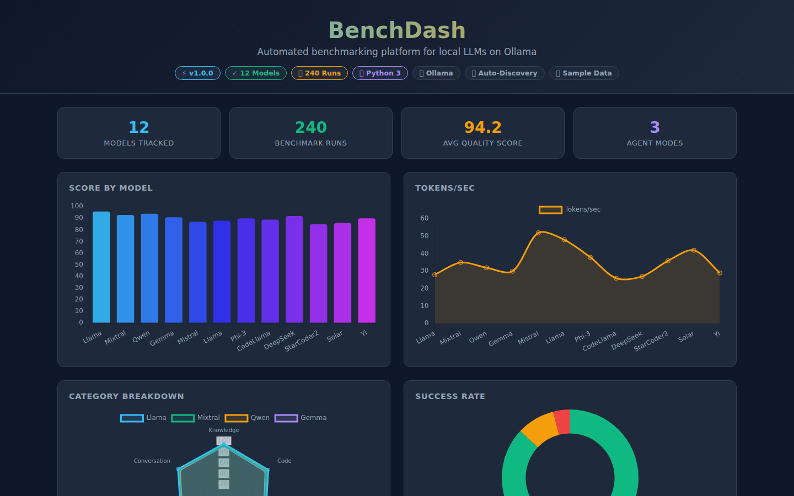
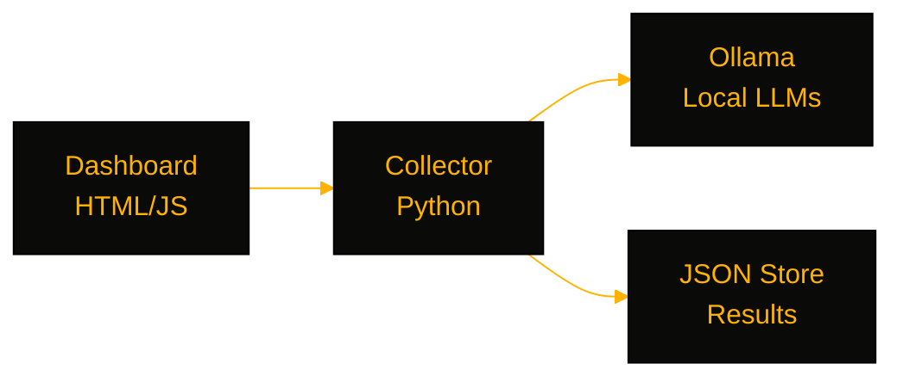

# benchova

> A benchmarking platform for local LLMs on Ollama — auto-discover models, run structured test suites, and compare accuracy, latency, and token throughput.

[](https://github.com/OneByJorah/benchova/actions)
[](https://github.com/OneByJorah/benchova/releases)
[](https://github.com/OneByJorah/benchova)
[](https://github.com/OneByJorah/benchova)
[](https://github.com/OneByJorah/benchova/stargazers)



## Why This Exists

Comparing local LLMs usually means ad-hoc prompts and a stopwatch. benchova makes that repeatable: discover the models Ollama has loaded, run a fixed task suite, and rank results on accuracy, latency, and throughput. Today the system-telemetry collector, dashboard UI, Docker packaging, and install scripts exist; the benchmark engine and scoring pipeline are on the roadmap.

> [!WARNING]
> **Pre-alpha.** The dashboard currently displays sample data. The benchmark engine, scoring pipeline, and JSON persistence are not yet implemented. The container serves the dashboard and collects system telemetry.

## Quick Start

```bash
git clone https://github.com/OneByJorah/benchova.git
cd benchova
docker compose up -d --build
```

Open **`http://localhost:8081`**. Or serve the dashboard directly: `python -m http.server 8081`.

## Features

- **System telemetry collector** — CPU, GPU, VRAM, CUDA, drivers, memory, and OS info gathered in Python (`collector/system_info.py`) and written to `results/system_info.json` on container start.
- **Static dashboard** — standalone `index.html` (no build step) showing model comparisons and system metrics, served by the container on port 8081.
- **Ollama integration (planned)** — enumerate local models via the Ollama API and run inference benchmarks.
- **Configurable benchmark tasks** — YAML definitions for categories, weights, and scoring (`j1.yaml`).
- **JSON persistence (planned)** — timestamped results for historical regression tracking.
- **Container packaging** — non-root Alpine image with healthcheck; `install.sh` and `install.ps1` installers.

## Quick Start (local, no Docker)

```bash
python3 collector/system_info.py
python3 -m http.server 8081
```

## Configuration

| Variable | Default | Description |
| --- | --- | --- |
| `OLLAMA_HOST` | `host.docker.internal:11434` | Ollama API endpoint (use `host.docker.internal` for Docker Desktop) |
| `DASHBOARD_PORT` | `8081` | Port the dashboard is served on |
| `DASHBOARD_HOST` | `0.0.0.0` | Bind address inside the container |
| `BENCH_SKIP_MEDIA` | `0` | Set to `1` to skip image/audio/video benchmark tests |
| `TELEGRAM_BOT_TOKEN` | — | Optional: Telegram notifications |
| `TELEGRAM_CHAT_ID` | — | Optional: Telegram chat for notifications |

## Architecture



## Stack

Python 3.11+ · Ollama · HTML/CSS/JS · Docker (Alpine) · Docker Compose

## Roadmap

See [ROADMAP.md](ROADMAP.md).

## Contributing

Read [INTENT.md](INTENT.md) for the design spec before opening a PR. [Open an issue](https://github.com/OneByJorah/benchova/issues) for bugs or ideas.

## Security

See [SECURITY.md](SECURITY.md).

## License

MIT — see [LICENSE](LICENSE).
